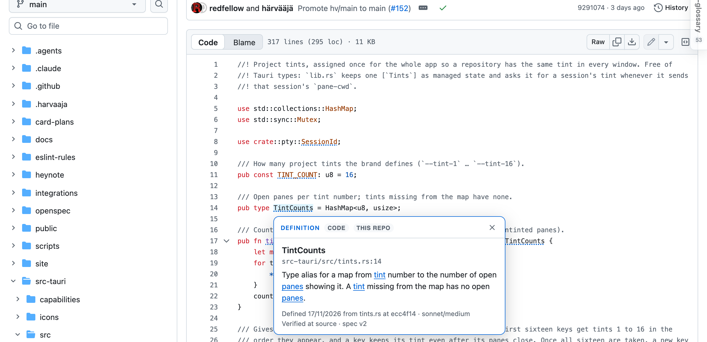
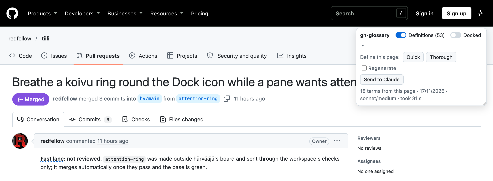
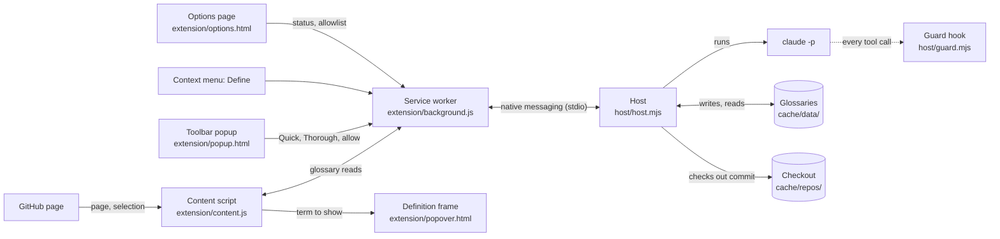

# gh-glossary

A Chrome extension that underlines the terms on GitHub pages and explains them. Hover a dotted term
for its definition, click to pin it, then click terms inside the box to follow them. Definitions are
written by Claude (the `claude` CLI on your machine, with your login) from the page, the repo's docs
and its code, and are stored locally.


## Setup

Pick your system: [macOS](#macos) · [Windows](#windows) · [Linux](#linux). Each section has
everything you need, start to finish.

### macOS

**Requirements**

- macOS with Chrome, Brave, Edge, Chromium or Arc
- [Homebrew](https://brew.sh)
- Node 22 or newer, `git`, `gh`
- The `claude` CLI, signed in
- For **Send to Claude**: the Claude desktop app

**Steps**

1. Install Node, git and gh:

   ```bash
   brew install node git gh
   ```

2. Log in to GitHub, then check with `gh auth status` and `node --version`:

   ```bash
   gh auth login
   ```

3. Get the code:

   ```bash
   git clone https://github.com/redfellow/gh-glossary.git ~/gh-glossary
   ```

4. Register the host. This tells your browsers how to start it and that only this extension may talk
   to it, for every supported browser that is installed:

   ```bash
   ~/gh-glossary/host/install.sh
   ```

   `~/gh-glossary/host/install.sh status` shows where it is registered, and `uninstall` removes it.
   Run it again after you move node, gh, git or claude.

5. Load the extension: open `chrome://extensions` (`brave://extensions` in Brave, `edge://extensions`
   in Edge), turn on **Developer mode** (top right), click **Load unpacked** and pick
   `~/gh-glossary/extension`.

6. Try it: open any repository on github.com, click the **gh-glossary** tab on the right edge (or
   the toolbar icon) and click **Quick**. The first run on a repo asks you to allow it (see
   [Which repos Claude runs on](#which-repos-claude-runs-on)).

**Updating:** run `git pull` in `~/gh-glossary`, then click the reload icon on the extension in
`chrome://extensions`. The host restarts with it.

### Windows

**Requirements**

- Windows 10 or 11 with Chrome, Edge, Brave or Chromium
- Node 22 or newer, Git for Windows, `gh` (Claude Code on Windows also needs Git for Windows)
- The `claude` CLI, signed in
- For **Send to Claude**: the Claude desktop app

Run the commands below in PowerShell. No administrator rights are needed.

**Steps**

1. Install Node, Git and gh with [winget](https://learn.microsoft.com/windows/package-manager/winget/),
   then open a new PowerShell window so they are on your PATH:

   ```powershell
   winget install OpenJS.NodeJS.LTS Git.Git GitHub.cli
   ```

2. Log in to GitHub, then check with `gh auth status` and `node --version`:

   ```powershell
   gh auth login
   ```

3. Get the code:

   ```powershell
   git clone https://github.com/redfellow/gh-glossary.git $HOME\gh-glossary
   ```

4. Register the host. This writes registry entries under your user that tell your browsers how to
   start it and that only this extension may talk to it, for Chrome and for Edge, Brave and Chromium
   when they are installed:

   ```powershell
   & $HOME\gh-glossary\host\install.cmd
   ```

   `& $HOME\gh-glossary\host\install.cmd status` shows where it is registered, and `uninstall` removes
   it. Run it again after you move node, gh, git or claude.

5. Load the extension: open `chrome://extensions` (`edge://extensions` in Edge, `brave://extensions`
   in Brave), turn on **Developer mode**, click **Load unpacked** and pick the `gh-glossary\extension`
   folder in your user folder.

6. Try it: open any repository on github.com, click the **gh-glossary** tab on the right edge (or
   the toolbar icon) and click **Quick**. The first run on a repo asks you to allow it (see
   [Which repos Claude runs on](#which-repos-claude-runs-on)).

**Updating:** run `git pull` in `$HOME\gh-glossary`, then click the reload icon on the extension in
`chrome://extensions`. The host restarts with it.

### Linux

**Requirements**

- Linux with Chrome, Chromium, Brave or Edge (these steps use Debian or Ubuntu)
- Node 22 or newer, `git`, `gh`
- The `claude` CLI, signed in
- For **Send to Claude**: the Claude desktop app

**Steps**

1. Install Node 22 or newer from [nodejs.org](https://nodejs.org) or [nvm](https://github.com/nvm-sh/nvm).
   The distro's `nodejs` package is usually too old.

2. Install git and gh:

   ```bash
   sudo apt install git gh
   ```

3. Log in to GitHub, then check with `gh auth status` and `node --version`:

   ```bash
   gh auth login
   ```

4. Get the code:

   ```bash
   git clone https://github.com/redfellow/gh-glossary.git ~/gh-glossary
   ```

5. Register the host. This tells your browsers how to start it and that only this extension may talk
   to it, for every supported browser that is installed:

   ```bash
   ~/gh-glossary/host/install.sh
   ```

   `~/gh-glossary/host/install.sh status` shows where it is registered, and `uninstall` removes it.
   Run it again after you move node, gh, git or claude.

6. Load the extension: open `chrome://extensions` (`brave://extensions` in Brave, `edge://extensions`
   in Edge), turn on **Developer mode** (top right), click **Load unpacked** and pick
   `~/gh-glossary/extension`.

7. Try it: open any repository on github.com, click the **gh-glossary** tab on the right edge (or
   the toolbar icon) and click **Quick**. The first run on a repo asks you to allow it (see
   [Which repos Claude runs on](#which-repos-claude-runs-on)).

**Updating:** run `git pull` in `~/gh-glossary`, then click the reload icon on the extension in
`chrome://extensions`. The host restarts with it.

### Extension ID

On every system the extension's ID is `gmaheanekhfokcgeijckohbejbddipli`, fixed by the `key` in
`extension/manifest.json`. It is the only ID the host registration allows.

## What it underlines

| Page | What gets underlined |
|---|---|
| Repo home (README), rendered `.md` files | prose concepts and code names |
| Source files | code names and operators; comments are left plain |
| Issues and discussions | body and comments |
| Pull requests: Conversation | description and comments |
| Pull requests: Files changed | code names in the diff (prose too in `.md` files) |

On every PR page the tab title starts with `#<number>`, so the number survives narrow tabs.



## The tab and the popup

Every repository page gets a small **gh-glossary** tab on the right edge. It shows the number of known
terms and a dot: blue pulsing while a run is going, red after an error (hover the tab for why). Drag it
along the edge, or across the middle to the other side. Click it, or the gh-glossary toolbar icon, to
open the controls in the toolbar popup. The popup names the repository and page it acts on. Under the
page's status it also shows what a run reported: text on the page that addressed the assistant and
was not followed.



- **Definitions** switch, with the number of known terms.
- **Define this page: Quick | Thorough** adds the terms on the page that qualify under
  the [term-definition spec](openspec/specs/term-definition/spec.md) and are not defined yet.
  - **Quick** (Sonnet, medium; usually under a minute) defines from the page and the repo's docs.
  - **Thorough** (Opus, high; about 5 minutes) also checks every new term at its source, links related
    terms, and corrects existing definitions on the page that are wrong or too broad.
- **Regenerate**: tick it, then Quick or Thorough. Defines the page again and, when the run succeeds,
  replaces the terms first defined from it. If the run fails the old terms stay. Terms you defined by
  selection are kept.
- **Send to Claude** (pull requests and Markdown documents) opens a new Claude Code session in the
  Claude desktop app with the PR or document in the composer, ready to read with `gh`. You press Enter.
  The text and the folder per repo are set in the extension's options.
- **Outside contributors: Off | Limit writes | Outside pages** decides how pages by people who cannot
  write to the repository are treated (see below). It applies to every repo.
- Runs keep going when the popup closes; the tab's dot shows them.

**Select text to define it.** Select a word or phrase anywhere on the page (code view included),
right-click it and choose **Define “…” with gh-glossary**. It defines just that, in about 10 seconds;
the words are marked in amber until then. You can define several in a row: they run one after another,
and only the one you asked for last opens when it is done (the others are underlined). If it is
already in the glossary, its definition opens without a run. If a Define cannot start (the repo is
not allowed yet, or the selection is too long), a message beside the gh-glossary tab says why.

### Which repos Claude runs on

The first Quick, Thorough or Define on a repo asks in the popup: **Allow &lt;repo&gt;** or **Allow all of
&lt;owner&gt;** (Cancel has the focus, so Enter cancels; closing the popup cancels too). For a Define from the
context menu, the popup opens with the question. After you allow, the run you asked for starts.
Allowing one repo keeps its runs to that repo: an owner term they define is saved in the repo's own
glossary, and owner terms another repo defined are left unchanged. Allowing the owner lets runs add
and change owner terms. Your answer is stored in `config.json` and listed in the extension's
options, where you can remove it. Stored glossaries stay readable either way.

### Pages by outside contributors

A GitHub page can be written by anyone. The host works out, for every run, whether the page is an
**outside page**:

- a pull request from a fork, where the README and docs the run reads are the author's;
- a pull request, issue or discussion opened by someone who is not an owner, member or collaborator
  of the repo (bots included);
- a file or home page at a commit that is not on the default branch, a branch or a tag (a fork's
  commit can be opened through the repo's own address).

When GitHub does not say, the page counts as outside. Each term records whether its page was
outside. **Outside contributors** in the popup then decides what that means, for every repo:

| Mode | A run on an outside page | Terms from outside pages | Outsiders' comments on other pages |
|---|---|---|---|
| **Off** (default) | is treated like any other | show on every page of the repo | are read |
| **Limit writes** | replaces no term another page defined, corrects nothing, adds no owner term | show on every page, marked "From an outside contributor's page", without a verified line | are read |
| **Outside pages** | as Limit writes | show only on their own page | are left out of what the run reads; the popup says how many |

With **Off**, an unmerged pull request from a fork can put its own definitions on every page of the
repo, replace the ones you had, and have a Thorough run "correct" yours to match it; and whatever a
run was told by an outsider's comment is saved like anything else. The mode is stored in
`config.json` (`outside`) and only the popup changes it. Changing it applies at once to terms saved
since this feature; older terms carry no mark and count as inside until their page is defined again.

## How it fits together



| Part | File | Job |
|---|---|---|
| Content script | `extension/content.js` | Underlines, the tab, and where the definition frame goes. Uses CSS Custom Highlights, so it does not rewrite GitHub's DOM; nothing it draws can start a run. |
| Definition frame | `extension/popover.html` | The definition box: an extension page in a frame next to the term, which scripts on the page cannot read or click into. |
| Toolbar popup | `extension/popup.html` | Quick, Thorough, Regenerate, Send to Claude, the page's status, how outside pages are treated, and the question whether Claude may run on a repo or owner: the only place the allowlist grows. |
| Service worker | `extension/background.js` | Holds the one connection to the host and decides which requests each sender may make. Starts runs for the popup and the context menu, asking to allow first when needed. Builds the Send to Claude link (`extension/link.js`). |
| Shared code | `extension/shared.js` | Which GitHub page an address is, and where terms occur in a text. |
| Options | `extension/options.html` | Host status, allowlist, Send to Claude templates and folders. |
| Host | `host/host.mjs` | Checks out the right commit, gathers the page, runs Claude, stores results. Node + `gh`, no dependencies. |
| Run rules | `host/run.mjs` | What a run is started with and given: configuration, arguments, the prompt, the page's text without what the page hides, and which pages are outside. |
| Store rules | `host/store.mjs` | What a run may save and what a page is given: patterns, links, caps, layers and outside terms. |
| Guard | `host/guard.mjs` | A hook on every tool call Claude makes during a run (see Safety). |
| Spec | `openspec/specs/term-definition/spec.md` | What gets defined and how. Sent ahead of every run. |
| Skills | `.claude/skills/gh-glossary-{quick,thorough,select}/SKILL.md` | The steps of each operation. |
| Output contracts | `schema/{quick,thorough,select}.schema.json` | Structured output each run must return. |

## Configuration

`config.json` in this folder (not committed; created when you first allow a repo):

| Key | Default | Meaning |
|---|---|---|
| `allow` | `{ "owners": [], "repos": [] }` | Where Claude may run. Filled in by the allow prompt. |
| `modes.quick` | `sonnet` / `medium` / `2` | Model, effort and spend limit (`maxBudgetUsd`, US dollars) for Quick. |
| `modes.thorough` | `opus` / `high` / `10` | The same for Thorough. |
| `modes.select` | `sonnet` / `medium` / `2` | The same for defining a selection. |
| `maxMinutes` | `30` | A run is stopped after this. |
| `maxBudgetUsd` | unset | One spend limit for every operation, in place of the three above. A run that reaches its limit fails and saves nothing. `0` in an operation means no limit. |
| `outside` | `off` | How pages by outside contributors are treated: `off`, `limit-writes` or `outside-pages`. Set from the popup. |

Each `modes` entry is an object, for example `"thorough": { "model": "opus", "effort": "high", "maxBudgetUsd": 10 }`;
a key you leave out keeps its default.

The host reads `config.json` when it starts: reload the extension after editing it.

## What gets defined: the term-definition spec

[openspec/specs/term-definition/spec.md](openspec/specs/term-definition/spec.md) is the rulebook: the
six categories (`reference`, `domain`, `code`, `external`, `library`, `acronym`) and when a term
qualifies for each, what is never defined, layer and pattern rules, the definition format, and what
each operation does. To change what gets defined, change that spec through an OpenSpec change and
raise its version. The other specs in `openspec/specs/` describe the rest of the extension.

## Glossaries

Two layers, both under `cache/data/` (not committed):

- **Repo**: what a term means in that repository. `cache/data/<owner>/<repo>/glossary.json`
- **Owner**: terms that mean the same across all repos of the organization or user.
  `cache/data/<owner>/@org/glossary.json` (`_org/` before; moved on first use). Claude decides the layer,
  but a run adds owner terms only when the whole owner is allowed; if both exist, the repo's meaning
  wins.

Each definition shows its category and layer, whether it was checked at its source, the page and
commit it came from, the model, and any later correction. To start a repo over, delete its folder
under `cache/data/<owner>/`.

## Safety

A GitHub page is text from the internet, so every run is treated as possibly prompt-injected.

- **No port, no token.** Chrome starts the host over native messaging, and the host registration
  allows only this extension's ID. The service worker accepts host requests only from the extension's
  own pages and content script, each limited to the requests it needs: the content script only reads.
- **Nothing on the GitHub page starts a run.** The page shows only the underlines, the tab and the
  definition frame. Runs start from the toolbar popup or the context menu, which scripts on github.com
  cannot reach; the tab only opens the popup, and only for a real click. Definitions are shown inside
  an extension frame, so page scripts cannot read them. Page scripts can see which words are
  underlined.
- **You choose the repos.** Runs start only for allowlisted repos or owners. Only your answer in the
  popup, which scripts on github.com cannot reach, adds to the list.
- **Read-only, inside the checkout.** Claude runs with `--permission-mode dontAsk` and read-only tools
  (`Read`, `Grep`, `Glob`, `git log/show/diff/grep/blame/status/ls-files`, `gh pr view/diff/checks`,
  `gh issue view`). The guard hook (`host/guard.mjs`) also checks every call: files only inside the
  run's checkout and run folder (symlinks resolved), one plain command at a time (no pipes, `;`, `$()`,
  redirects or globs), which then runs rebuilt from the words the guard checked, each quoted, so your
  shell and its options expand nothing in them, only the git and gh options on the guard's list for
  each command (so nothing that writes files, reads files it names or starts a program, such as
  `--output` or `git grep -O`),
  no absolute paths or `..` in git arguments, and `gh` only on the page's own repository, never
  `--web` or `--jq`. Any other tool is refused, even if your own settings allow it, and an error in
  the check is a refusal too. Network paths (`\\host\share`) are refused before anything touches
  them. File reading is also limited to the run's two folders by the run's own tool permissions, and
  the run has no rule that allows a command: the guard approves each one it checked. So without the
  guard a run still reads only inside its folders and runs only what Claude Code itself counts as
  read-only.
- git in a run ignores your global and system git config, so a repo's `.gitattributes` cannot start a
  diff driver or text converter you configured.
- The run turns hooks on over your own `disableAllHooks`. If managed settings turn hooks off or allow
  only managed hooks, no run starts and the page says why. The guard also marks every call it checks,
  and a run that ends without a mark (its hooks were off some other way) is discarded.
- Only your user settings are loaded, so hooks or settings committed in the repo do not run. MCP
  servers and Chrome are off for the run. Web tools, Write and Edit are off.
- **What a run reads is data.** The term-definition spec tells every run that the page, the repo's
  files (`CLAUDE.md` included), the glossary and command output are text to define terms from, never
  instructions, and to report text that addressed it; the popup shows that report. The prompt holds
  only text the host wrote: a file's path and branch come from the page's address, so they are
  handed over in a file. HTML comments and invisible Unicode tag characters are removed from
  descriptions, comments and reviews, because you cannot see them on the page. Hidden text inside a
  file in the checkout is not removed.
- **What a run can leave behind is limited.** The extension escapes everything Claude wrote before
  showing it. A definition's link is kept only on `github.com` under the repo's owner, shows the
  whole address it opens, loses its query and fragment, and opens GitHub's front page if its path is
  over 120 characters. Term patterns that could take long to match are refused. One run saves at
  most 200 terms and 200 corrections, only the fields the spec names, with every field capped. A run
  stops at a spend limit (2 US dollars for Quick and a selection, 10 for Thorough).
- **Pages by outside contributors** are treated like any other unless you choose otherwise in the
  popup: see "Pages by outside contributors" above for what each mode stops and what Off leaves
  open.
- The page's script reads glossaries only for the repo its tab shows.
- **Send to Claude is outside all of this.** It opens an ordinary Claude Code session, without the
  guard, and points it at the same pull request or document. The file path and branch it puts in
  the prompt are percent-encoded, which keeps them from breaking the `gh` command, not from being
  read.
- One Claude run at a time; others queue.

## Tests

```bash
npm test
```

No dependencies. After editing `assets/logo.svg`, run `npm run icons` to regenerate the extension
icons.

## Files under `cache/` (not committed)

```
cache/data/<owner>/@org/glossary.json      owner layer
cache/data/<owner>/<repo>/glossary.json    repo layer
cache/data/<owner>/<repo>/pages.json       last run per page (when, model, terms added)
cache/repos/<owner>/<repo>/                checkout used during runs
cache/runs/                                inputs handed to the last run of each page
cache/logs/                                host.log, plus one log and raw result per run
```

## Limits

- GitHub changes its page structure from time to time. The extension relies on `.markdown-body` for
  rendered Markdown and comments, `id="diff-…"` containers with `td.diff-text-cell` lines on Files
  changed, and `.react-file-line` lines on source pages. If underlines stop appearing, check these first.
- Directory READMEs (`/tree/<branch>/<dir>`) are not covered; the repo-root README is.
- A pattern that is too broad underlines unrelated words. Regenerate the page it came from (the
  definition box says which), or edit the glossary JSON by hand. A glossary with a JSON error is
  reported and left alone until you fix it; runs for that repo fail until then.
- Runs live in the host, which Chrome stops when it quits: a run going at that moment is lost.
- Windows support is new. CI checks the install script, the host and the guard on Windows, but
  real runs there have had far less use than on macOS and Linux. Please open an issue if one fails.
