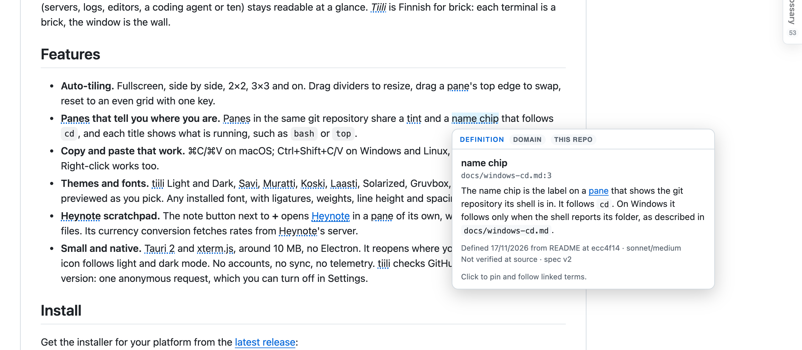

# GitHub Glossary

A Chrome extension that underlines the terms on GitHub pages and explains them. Hover a dotted term
for its definition, click to pin it, then click terms inside the box to follow them.

Definitions are written by Claude, using the `claude` CLI on your own machine and your own login,
from the page, the repository's docs and its code. They are stored on your machine.



## Setup

Pick your system: [macOS](#macos) · [Windows](#windows) · [Linux](#linux).

### macOS

**You need:** Chrome, Brave, Edge, Chromium or Arc; [Homebrew](https://brew.sh); the `claude` CLI,
signed in; and for **Send to Claude**, the Claude desktop app.

1. Install Node (22 or newer), git and the GitHub CLI, and log in to GitHub:

   ```bash
   brew install node git gh
   ```

   ```bash
   gh auth login
   ```

2. Get the code:

   ```bash
   git clone https://github.com/redfellow/gh-glossary.git ~/gh-glossary
   ```

3. Connect it to your browsers (every supported browser that is installed):

   ```bash
   ~/gh-glossary/host/install.sh
   ```

4. Load the extension: open `chrome://extensions` (`brave://extensions`, `edge://extensions`), turn on
   **Developer mode**, click **Load unpacked** and pick `~/gh-glossary/extension`.

5. Open any repository on github.com, click the **GitHub Glossary** tab on the right edge and click
   **Quick**.

### Windows

**You need:** Windows 10 or 11 with Chrome, Edge, Brave or Chromium; the `claude` CLI, signed in; and
for **Send to Claude**, the Claude desktop app. Run the commands in PowerShell; no administrator rights
are needed.

1. Install Node, Git and the GitHub CLI, open a new PowerShell window, and log in to GitHub:

   ```powershell
   winget install OpenJS.NodeJS.LTS Git.Git GitHub.cli
   ```

   ```powershell
   gh auth login
   ```

2. Get the code:

   ```powershell
   git clone https://github.com/redfellow/gh-glossary.git $HOME\gh-glossary
   ```

3. Connect it to your browsers:

   ```powershell
   & $HOME\gh-glossary\host\install.cmd
   ```

4. Load the extension: open `chrome://extensions` (`edge://extensions`, `brave://extensions`), turn on
   **Developer mode**, click **Load unpacked** and pick the `gh-glossary\extension` folder in your user
   folder.

5. Open any repository on github.com, click the **GitHub Glossary** tab on the right edge and click
   **Quick**.

### Linux

**You need:** Chrome, Chromium, Brave or Edge; the `claude` CLI, signed in; and for **Send to
Claude**, the Claude desktop app. The steps below are for Debian and Ubuntu.

1. Install Node 22 or newer from [nodejs.org](https://nodejs.org) or [nvm](https://github.com/nvm-sh/nvm)
   (the distro's package is usually too old), then git and the GitHub CLI, and log in to GitHub:

   ```bash
   sudo apt install git gh
   ```

   ```bash
   gh auth login
   ```

2. Get the code:

   ```bash
   git clone https://github.com/redfellow/gh-glossary.git ~/gh-glossary
   ```

3. Connect it to your browsers:

   ```bash
   ~/gh-glossary/host/install.sh
   ```

4. Load the extension: open `chrome://extensions` (`brave://extensions`, `edge://extensions`), turn on
   **Developer mode**, click **Load unpacked** and pick `~/gh-glossary/extension`.

5. Open any repository on github.com, click the **GitHub Glossary** tab on the right edge and click
   **Quick**.

### Updating and removing

- **Update:** run `git pull` in the `gh-glossary` folder, then click the reload icon on the extension
  in `chrome://extensions`.
- **Check or remove the browser connection:** run the install script with `status` or `uninstall`.
  Run it again (with no argument) if you move node, gh, git or claude.

## Using it

### Where terms are underlined

| Page | What gets underlined |
|---|---|
| Repository home (README) and Markdown files | concepts and code names |
| Source files | code names and operators, not comments |
| Issues and discussions | the description and comments |
| Pull requests | the description and comments, and code names in the changed files |


### The tab and the popup

Every repository page gets a small **GitHub Glossary** tab on the right edge with the number of known
terms. A blue pulsing dot means a run is going; a red dot means something failed (hover the tab to see
why). Drag the tab along the edge or to the other side. Click it, or the toolbar icon, to open the
popup.


- **Definitions** turns the underlines on and off.
- **Quick** (usually under a minute) defines the new terms on the page from the page and the
  repository's docs.
- **Thorough** (about 5 minutes) also checks each new term in the code, links related terms, and fixes
  existing definitions on the page that are wrong or too broad.
- **Regenerate**: tick it, then Quick or Thorough, to define the page again from scratch. If the run
  fails, the old definitions stay.
- **Send to Claude** (pull requests and Markdown files) opens a new Claude Code session in the Claude
  desktop app with the PR or document ready to read. You press Enter. Its text and the folder used for
  each repository are set in the extension's options.
- **Outside contributors** sets how pages written by people outside the repository are handled (see
  [Security](#security)).

Runs keep going after the popup closes; the tab's dot shows their progress.

### Define a selection

Select a word or phrase anywhere on a page, right-click it and choose **Define “…” with GitHub
Glossary**. It takes about 10 seconds; the words are marked in amber until it is done. If the term is
already known, its definition opens straight away.

### Choosing which repositories it runs on

The first time you run it on a repository, the popup asks whether to **Allow &lt;repo&gt;** or **Allow
all of &lt;owner&gt;**. Your answers are listed in the extension's options, where you can remove them.

## Security

A GitHub page is text from the internet that anyone may have written, and some of it may try to give
Claude instructions. GitHub Glossary is built so that such text cannot make Claude do anything harmful.

- **Nothing on a GitHub page can start a run.** Runs start only from the toolbar popup or the
  right-click menu, which websites cannot reach. Definitions are shown in a box the page's own scripts
  cannot read.
- **You choose the repositories.** Claude runs only on repositories or owners you have allowed, and
  only your own click in the popup can allow one.
- **Claude can only read.** During a run Claude can read files and look at git and GitHub history, and
  nothing else: no writing or editing files, no web access, no other programs. A guard checks every
  single step Claude takes and refuses anything outside that list, including reading files outside the
  repository's copy.
- **Neither the repository nor your setup can loosen it.** Settings and hooks committed in the
  repository are ignored, your MCP servers are off, and the guard refuses tools even if your own
  settings allow them. If the guard cannot run, no run starts; if a run ends without
  the guard having checked it, its results are thrown away.
- **Page text is treated as data, not instructions.** Claude is told that everything it reads is only
  material to define terms from. Text that tried to give it instructions is reported in the popup.
  Hidden text in comments and descriptions (that you could not see on the page) is removed first.
- **What a run saves is limited.** Every definition is escaped before it is shown, links can only
  point to the repository owner's pages on github.com, and each run is capped in how many terms it can
  save, how long it can take (30 minutes) and how much it can spend ($2 for Quick and a selection, $10
  for Thorough).
- **Outside contributors can be kept at a distance.** Pull requests from forks, and pages started by
  people who cannot write to the repository, count as outside pages. In the popup you choose:

  | Mode | What it does |
  |---|---|
  | **Off** (default) | Outside pages are treated like any other. |
  | **Limit writes** | A run on an outside page cannot replace or correct other definitions. Its terms are marked “From an outside contributor's page”. |
  | **Outside pages** | As Limit writes, and terms from an outside page show only on that page. Comments by outsiders on other pages are not read. |

  With **Off**, an unmerged pull request from a fork can change definitions shown on every page of the
  repository.
- **No open port, no token.** The browser starts the local part directly, and only this extension may
  talk to it.

**Send to Claude** is not covered by the above: it opens an ordinary Claude Code session, with your
usual permissions, pointed at the pull request or document.

## Settings

Most settings are in the popup and the extension's options page. Models and limits are in
`config.json` in the `gh-glossary` folder (created the first time you allow a repository). Reload the
extension after editing it.

| Setting | Default | Meaning |
|---|---|---|
| `modes.quick` | `sonnet`, `medium`, `2` | Model, effort and spend limit in US dollars for Quick |
| `modes.thorough` | `opus`, `high`, `10` | The same for Thorough |
| `modes.select` | `sonnet`, `medium`, `2` | The same for defining a selection |
| `maxMinutes` | `30` | A run is stopped after this |
| `maxBudgetUsd` | not set | One spend limit for everything, in place of the three above |

For example: `{ "modes": { "thorough": { "model": "opus", "effort": "high", "maxBudgetUsd": 10 } } }`.
A setting you leave out keeps its default.

## Your data

Everything is kept in the `cache/` folder inside `gh-glossary`:

- `cache/data/<owner>/<repo>/`: the glossary of one repository
- `cache/data/<owner>/@org/`: terms shared by all repositories of an owner (only when you allowed the
  whole owner)
- `cache/repos/`: the copies of repositories that runs read from
- `cache/logs/`: logs of the runs

To start a repository over, delete its folder under `cache/data/<owner>/`.

What gets defined, and how, is set out in the
[term-definition spec](openspec/specs/term-definition/spec.md).

## Known limits

- If underlines stop appearing, GitHub has probably changed its page layout. Please open an issue.
- Folder READMEs (other than the repository's main README) are not covered.
- A definition that underlines unrelated words can be fixed by regenerating the page it came from (the
  definition box says which).
- A run going on when the browser quits is lost.
- Windows support is new; please open an issue if something fails there.

## Development

```bash
npm test
```

No dependencies. After editing `assets/logo.svg` or `assets/logo-16.svg`, run `npm run icons` to
rebuild the extension icons (needs Chrome; set `CHROME` if it is not found).
